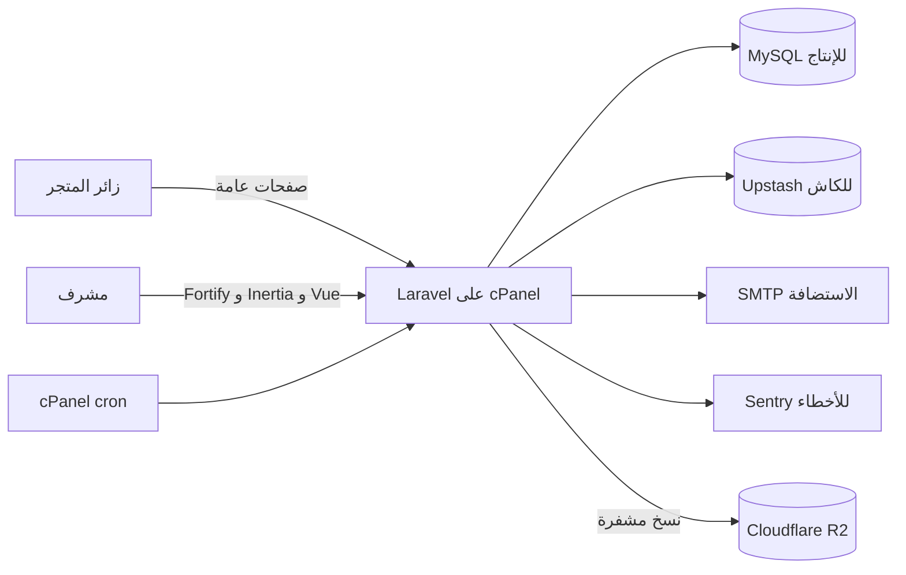

# 0001. معمارية متجر الإحالة

**Date**: 2026-11-07
**Status**: Accepted

## Summary

هذا القرار يجهز تطبيقًا واحدًا لمتجر الإحالة ولوحة إدارته. يستخدم التطبيق Laravel مع صفحات عامة جاهزة لمحركات البحث ولوحة تفاعلية مبنية على Vue. يحترم اختيارك لاستضافة cPanel، ويجعل التحقق من توافق الخطة شرطًا قبل شرائها.

## Requirements

**قصص الاستخدام**:

1. بصفتي زائرًا، أريد عرض المنتجات بالعربية والإنجليزية حتى أتمكن من العثور عليها ومشاركة صفحاتها.
2. بصفتي مشرفًا، أريد دخولًا محميًا وإدارة المنتجات والصلاحيات ومتابعة أرقام المشاهدة والنقر.
3. بصفتي مالك الموقع، أريد نشر التطبيق على استضافة PHP مشتركة واستعادة البيانات عند فقدها.

**القيود المؤكدة**:

1. PHP 8.4 وLaravel 13.
2. MySQL للإنتاج، وSQLite للتطوير المحلي.
3. Inertia مع Vue 3 وTypeScript وBootstrap.
4. الاستضافة المشتركة عبر cPanel، وقاعدة MySQL على الخادم نفسه.
5. لا يوجد تسجيل عام. ينشأ أول حساب Super Admin عند التجهيز، ثم ينشئ المشرفون الحسابات الأخرى.
6. الزيارات منخفضة في البداية، وحجم فريق التطوير غير محدد.
7. يرسل البريد عبر SMTP الخاص بالاستضافة، وتصل تنبيهات الأعطال إلى حسابات Super Admin.

**Acceptance criteria**:

1. **AC-1**: يعمل التطبيق محليًا على PHP 8.4 وLaravel 13 مع SQLite.
2. **AC-2**: تستخدم صفحات المتجر HTML مولدًا من Laravel، وتستخدم لوحة الإدارة Inertia وVue، وتعمل ملفات الواجهة المبنية من دون خادم Node دائم في الإنتاج.
3. **AC-3**: يختار الإعداد المحلي SQLite، ويختار إعداد الإنتاج MySQL 8.4 أو 8.0 من دون تغيير شيفرة التطبيق.
4. **AC-4**: تأتي بيانات اعتماد Redis وSMTP وSentry وR2 من إعدادات البيئة، ولا تحفظ الأسرار في مستودع Git.

## Decision

**Chosen option**: Option 1: تطبيق Laravel واحد بواجهة عامة من الخادم ولوحة Inertia مع Vue.

اعتمد تطبيقًا أحاديًا قابلًا للتقسيم حسب مجالاته، مع قاعدة MySQL واحدة في الإنتاج، وSQLite محليًا. صفحات المتجر العامة تصدر HTML من Laravel، ولوحة الإدارة تستخدم Inertia وVue.

## Proposed stack

| الطبقة | الاختيار | السبب |
|---|---|---|
| بنية التطبيق | تطبيق Laravel واحد، مقسم حسب مجال الكتالوج والإدارة والتتبع | التطبيق صغير ولا يحتاج خدمات مستقلة أو فريق تشغيل |
| لغة الخادم | PHP 8.4 | إصدارك المختار يتجاوز الحد الأدنى الحالي لإطار Laravel 13 |
| إطار الخادم | Laravel 13، مع Composer وLaravel Installer | يلبي اختيارك ويجمع المسارات والجلسات والمهام والملفات في إطار واحد |
| قاعدة الإنتاج | MySQL 8.4 LTS إن توفر، وإلا أحدث إصدار MySQL 8.0 تدعمه الاستضافة، مع ترميز utf8mb4 | يحترم اختيارك ويدعم النصوص العربية والإنجليزية والبحث النصي الكامل |
| قاعدة التطوير | SQLite محليًا مع Laravel migrations | يسهل التشغيل المحلي من دون خادم قاعدة بيانات منفصل |
| طبقة البيانات | Eloquent وLaravel migrations | أداة Laravel المدمجة للقراءة والكتابة وترحيل المخطط |
| الصفحات العامة | Laravel Blade لتوليد الصفحات على الخادم | يتيح فهرسة صفحات المنتجات من دون تشغيل خادم Node |
| لوحة الإدارة | Inertia 3 وVue 3 وTypeScript عبر مسارات Laravel | يعطي لوحة تفاعلية مع بقاء الواجهة والخادم في مشروع واحد |
| تنسيق الواجهة | Bootstrap 5.3.8 | خيارك، وهو الإصدار المستقر الحالي عند كتابة القرار |
| بناء ملفات الواجهة | Node وnpm وVite محليًا، ثم إرفاق ملفات البناء بإصدار Git | يحتاج Node أثناء البناء فقط، لا أثناء تشغيل الموقع |
| تسجيل الدخول | Laravel Fortify مع واجهة مخصصة وجلسات المتصفح | يخدم تسجيل الدخول واستعادة كلمة المرور من دون بناء المصادقة من الصفر |
| التسجيل والتحقق | إيقاف التسجيل العام، توفير تحقق اختياري بخطوتين، وإنشاء الحساب الأول أثناء التجهيز | يحصر الدخول على فريق الإدارة ويحافظ على خيار التحقق الذي اخترته |
| الأدوار والصلاحيات | Spatie Laravel Permission 8 مع Laravel Gates وPolicies | يتيح أدوارًا وصلاحيات قابلة للإدارة، ويدعم Laravel 13 |
| بحث المنتجات | فهارس FULLTEXT في MySQL مع فلاتر SQL | يلائم حجم البداية من دون خدمة بحث إضافية |
| بحث التطوير المحلي | بحث LIKE عند استخدام SQLite | يحافظ على إمكانية تشغيل البحث محليًا مع اختلاف محركي قاعدة البيانات |
| كاش الإنتاج | Upstash Redis عبر TLS باستخدام Predis، مع Laravel failover store ينتقل إلى file cache عند تعطل Redis | يناسب الاستضافة التي لا تضمن إضافة PHP خاصة بـRedis، ويتيح استمرار الكاش المحلي عند انقطاع الخدمة، ويجب اختبار التحويل |
| كاش التطوير المحلي | Laravel file cache | يمنع حاجة بيئة Windows المحلية إلى خادم Redis |
| جلسات الإنتاج والمحلي | ملفات Laravel على الخادم | يناسب خادم تطبيق واحد ولا يضيف ضغط جلسات على قاعدة البيانات |
| الطوابير | طابور قاعدة بيانات في MySQL يشغله cPanel cron، مع تسجيل المشاهدات والنقرات مباشرة أثناء طلب الويب | يعمل من دون عامل دائم، ويحافظ على تسجيل الإحصاءات حتى إذا تأخر cron |
| صور المنتجات | قرص Laravel المحلي، خارج نسخة R2 الاحتياطية لقاعدة البيانات | يوافق اختيارك، لكن فقدان الخادم قد يؤدي إلى فقد ملفات الصور |
| اتصال النسخ بـR2 | Laravel S3 disk مع `league/flysystem-aws-s3-v3` | يدعم Cloudflare R2 عبر واجهة S3 المتوافقة |
| البريد | SMTP المقدم من الاستضافة، وسجل محلي أثناء التطوير | يخدم استعادة الحساب وتنبيهات التشغيل من دون مزود إضافي |
| مراقبة الأعطال | Sentry للواجهة والخادم، مع تنقيح كلمات المرور والرموز وحقول النماذج قبل الإرسال | يجمع أخطاء Vue وLaravel في مكان واحد من دون تسجيل بيانات الدخول |
| النسخ الاحتياطي | Spatie Laravel Backup 10، نسخة قاعدة بيانات يومية إلى حاوية Cloudflare R2 خاصة، بتشفير AES 256 واحتفاظ 30 يومًا | يفصل نسخة قاعدة البيانات عن خادم الموقع |
| مفاتيح النسخ | نسخة استرداد لمفتاح التشفير في مدير أسرار منفصل عن الخادم وR2 | تمكّن الاستعادة عند فقد إعدادات الخادم |
| اختبار الاستعادة | استعادة تجريبية كل ثلاثة أشهر | يتحقق من صلاحية الأرشيف والمفتاح وإجراء الاستعادة |
| التنبيهات | بريد إلى جميع الحسابات ذات دور Super Admin عند تعطل النسخ أو المهام | يطابق مستلمي التنبيه الذين اخترتهم |
| استضافة الإنتاج | PHP مشتركة عبر cPanel، وMySQL على الخادم نفسه | خطة الاستضافة التي اخترتها |
| نشر الشيفرة | مستودع GitHub خاص يسحبه cPanel عبر SSH، وملفات Vue وCSS المبنية محليًا مضمّنة في إصدار Git | يتيح نشرًا من دون Node دائم على الخادم |
| بروتوكول التطبيق | مسارات ويب وجلسات Laravel، بلا واجهة API عامة منفصلة | الزوار والمشرفون يستخدمون الموقع نفسه |

## Architecture sketch

## Consequences

**إيجابيات**:

1. يبقى التطبيق في مشروع ونشر واحد.
2. تظهر صفحات المتجر كـHTML من الخادم، ولا تحتاج تشغيل Node دائمًا.
3. تبقى بيانات التطبيق الأصلية في MySQL، والكاش قابل لإعادة الإنشاء.
4. تكون النسخ اليومية خارج خادم التطبيق ومشفرة.

**سلبيات وتكاليف**:

1. يعتمد الكاش والنسخ والمراقبة على خدمات خارجية واتصال الشبكة من cPanel.
2. يلزم وجود Node على جهاز التطوير لبناء Vue وBootstrap، وحفظ الملفات المبنية ضمن إصدار Git.
3. تشترك قاعدة البيانات والتطبيق في الخادم نفسه، لذلك يمكن لعطل الخادم إيقاف كليهما.
4. يستخدم SQLite محليًا وMySQL في الإنتاج. تختلف بعض نتائج البحث وسلوكيات قاعدة البيانات بينهما.

**آثار أخرى**:

1. يؤدي فقدان قاعدة البيانات بين نسختين احتياطيتين إلى فقد تغييرات منذ آخر نسخة، بحد أقصى يوم واحد وفق الجدول المختار.
2. النسخة الاحتياطية تشمل قاعدة البيانات فقط. صور المنتجات على قرص الخادم ولا توجد لها نسخة R2 في هذا القرار.
3. يجب التحقق من استعادة نسخة احتياطية كل ثلاثة أشهر، لا من نجاح رفعها فقط.
4. يعتمد بحث MySQL النصي الكامل على الكلمات والفهرسة، ولا يقدم تصحيحًا للأخطاء أو مرادفات. تحدد مواصفة الكتالوج تفاصيل البحث والترتيب.

## Follow-up

1. [ ] قبل شراء خطة cPanel، تحقق من PHP 8.4 وامتداداته المطلوبة، وComposer، وSSH وGitHub عبر SSH، وcron، وتوجيه جذر الموقع إلى مجلد public، وMySQL 8.4 أو أحدث 8.0 مدعوم.
2. [ ] تحقق من السماح بالاتصالات الصادرة عبر TLS إلى Upstash وR2 وSentry وSMTP، ومن حدود الموارد ومساحة القرص والملفات المؤقتة.
3. [ ] تحقق من تشغيل mysqldump عبر proc_open، ودعم ZipArchive لتشفير AES 256، وإمكانية إنشاء storage:link أو بديل، وتشغيل جدولة cPanel.
4. [ ] خزّن مفاتيح الخدمات وكلمة تشفير النسخة في إعدادات الخادم خارج Git، واحتفظ بنسخة استرداد لمفتاح التشفير في مدير أسرار منفصل عن الخادم وR2.
5. [ ] نفذ اختبار استعادة لقاعدة البيانات كل ثلاثة أشهر. لا تشمل النسخة صور المنتجات.
6. [ ] حدد قبل تفعيل الطابور توقيت cron وأمره وحد التشغيل ومنع التداخل وإعادة المحاولة بما يلائم حدود الخطة.
7. [ ] تم تجاوز تثبيت Agent Skills وتوصيل MCP في هذه المرحلة. سجل التجاوز في AGENTS.md عند تشغيل /audit لتجنب إعادة السؤال.
8. [ ] ميزات نموذج البيانات وأساس الواجهة وصلاحيات المشرفين لها صفوف مستقلة في النطاق، وتحتاج مواصفاتها قبل تنفيذ تلك الميزات.

## Rationale

راجع [rationale.md](rationale.md) لمعرفة الخيارات التي قورنت وأسباب القرار.

